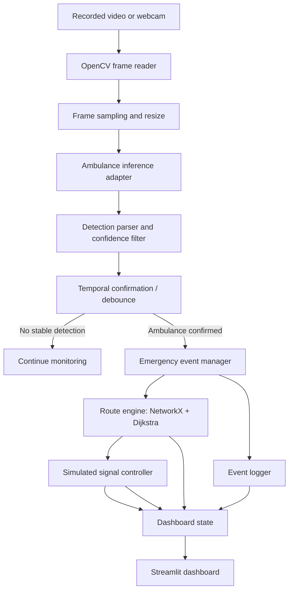
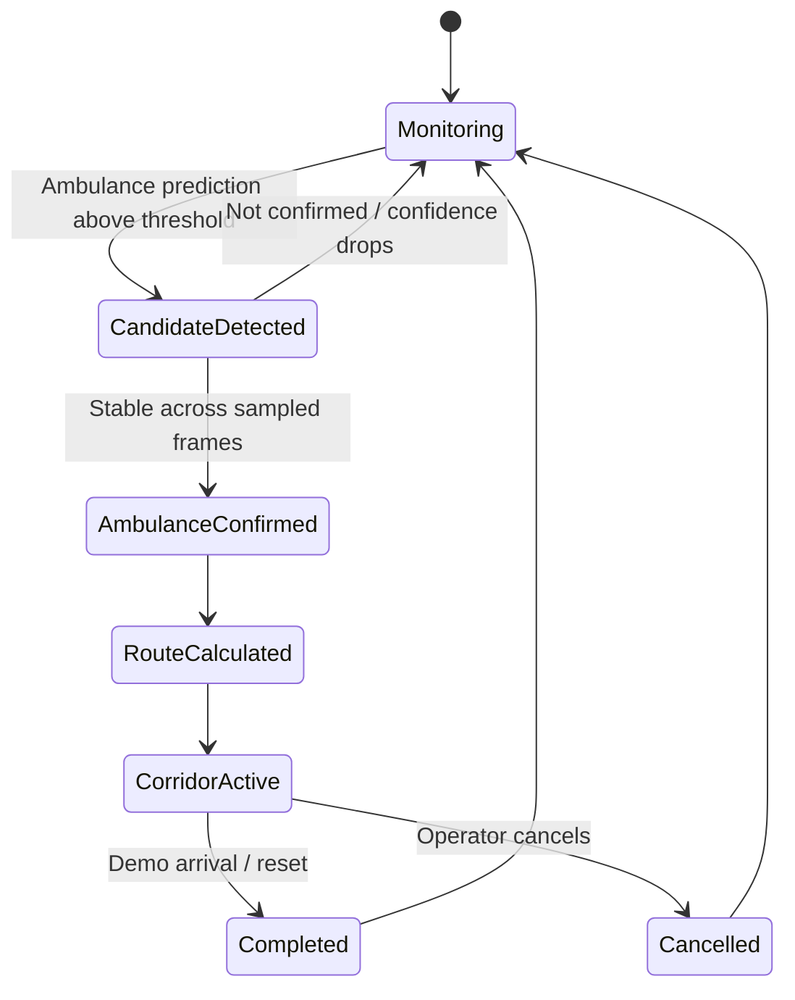

# SafeCity AI --- Technical Architecture & System Flow

**Project:** SafeCity AI --- Ambulance Green Corridor\
**Version:** 1.0\
**Purpose:** Hackathon-ready prototype based on the approved dashboard
reference image.\
**Scope:** Ambulance detection from recorded video or webcam, simulated
multi-intersection route, simulated signal prioritisation, and event
logging. No real traffic signal control or real emergency dispatch.

------------------------------------------------------------------------

## 1. Product Summary

SafeCity AI demonstrates how an ambulance detected by a camera could
receive priority across a sequence of simulated traffic intersections.
The application processes a video feed, detects an ambulance using a
hosted or local computer-vision model, calculates a route on a small
road graph, and updates a Streamlit dashboard.

The dashboard follows the supplied reference image: - Left navigation:
Live Monitor, Route & Map, Signal Control, Event History, Analytics,
CCTV Sources, Hospital Locations, System Settings. - Main area:
CCTV/video panel with detections. - Status cards: Ambulance Detected,
Estimated Arrival, Current Speed (simulated/estimated). - Route panel:
route line, intersections, hospital destination, ETA. - Lower panels:
Traffic Signals Status, Route Progress, Event Log. - Emergency mode
indicator and Rescue Support information panel.

For a three-hour hackathon, the navigation can be visual, but only the
core screens need working interactions. Do not build unrelated modules
such as crash detection, general traffic optimisation, user accounts, or
a production dispatch system.

## 2. Goals and Non-Goals

### Goals

1.  Accept a recorded video file; webcam support is optional.
2.  Detect an ambulance using a pre-trained ambulance-specific model.
3.  Display detection boxes, labels, and confidence where the chosen
    inference SDK exposes them.
4.  Trigger a simulated emergency-priority event after stable detection.
5.  Calculate a route between a configurable start intersection and a
    hospital using Dijkstra's algorithm.
6.  Mark route intersections as `PRIORITY_GREEN` in the simulation.
7.  Show route progress, signal states, ETA estimate, and event history.
8.  Keep the demo honest: distinguish real model output from simulated
    route, signals, speed, and ETA.

### Non-Goals

-   Controlling real traffic lights or roadside hardware.
-   Sending operational alerts to Rescue 1122.
-   Claiming that the system is certified for emergency use.
-   Automatically discovering an ambulance's real destination from
    video.
-   Reliable siren/audio recognition in the MVP.
-   Crash detection, lane-density optimisation, or multi-camera identity
    matching.
-   Training a model from scratch.

## 3. Recommended Stack

  -----------------------------------------------------------------------
  Layer                   Technology              Responsibility
  ----------------------- ----------------------- -----------------------
  Language                Python 3.11 or a        Application logic
                          compatible version      
                          supported by            
                          dependencies            

  UI                      Streamlit               Dashboard, controls,
                                                  status panels

  Video                   OpenCV                  Read video, resize
                                                  frames, draw detections

  Detection               Roboflow hosted         Ambulance detection
                          inference via           
                          `inference-sdk` OR      
                          local compatible YOLO   
                          weights                 

  Routing                 NetworkX                Road graph and shortest
                                                  path

  Data models             Python dataclasses /    Events, route and
                          TypedDict (optional)    signal state

  Persistence             JSON file or SQLite     Event history for demo
                          (optional)              

  Configuration           `.env` / environment    API key and runtime
                          variables               settings
  -----------------------------------------------------------------------

### Model strategy

Preferred fast path: use the Roboflow hosted inference snippet for the
selected ambulance-specific model, after checking that the model
endpoint is accessible and its free-tier limits are suitable. Store the
API key in an environment variable, never in source code.

Fallback: download compatible model weights and run local inference if
available. Standard COCO YOLO weights do not normally have a dedicated
ambulance class; verify the model's class labels before implementation.
Do not spend hackathon time training a model unless detection
demonstrably fails and time remains.

## 4. High-Level Architecture



### Architectural principle

Keep the model provider behind a small adapter function, for example
`detect_ambulance(frame)`. This allows switching between hosted Roboflow
inference and local YOLO without rewriting routing or UI code.

## 5. Suggested Project Structure

``` text
safecity-ai/
├── app.py                      # Streamlit entry point
├── requirements.txt
├── .env.example                # Placeholder only; never commit real keys
├── README.md
├── config/
│   └── settings.py             # Thresholds, model ID, demo defaults
├── assets/
│   ├── demo_traffic.mp4        # User-provided/test clip, if permitted
│   └── logo.png                # Optional
├── safecity/
│   ├── __init__.py
│   ├── video_source.py         # Upload/webcam frame source
│   ├── detector.py             # Hosted/local inference adapter
│   ├── detection_logic.py      # Parse, filter, debounce detections
│   ├── route_engine.py         # Road graph and Dijkstra path
│   ├── signal_simulator.py     # Simulated signal states
│   ├── event_manager.py        # Start/end emergency event lifecycle
│   ├── event_store.py          # In-memory/JSON event history
│   ├── models.py               # Detection, Route, Signal, Event models
│   └── ui_components.py        # Reusable dashboard components
└── tests/
    ├── test_route_engine.py
    ├── test_signal_simulator.py
    └── test_detection_logic.py
```

For a three-hour build, reduce this to `app.py`, `detector.py`,
`route_engine.py`, and `signal_simulator.py` if the full structure slows
development.

## 6. Core Data Models

Example conceptual models:

``` python
Detection:
    label: str
    confidence: float
    bbox: tuple[int, int, int, int]
    timestamp: float

EmergencyEvent:
    event_id: str
    status: str  # DETECTED, ROUTE_ASSIGNED, CORRIDOR_ACTIVE, COMPLETED, CANCELLED
    detected_at: str
    source_camera: str
    start_node: str
    destination_node: str
    route_nodes: list[str]
    confidence: float

Signal:
    intersection_id: str
    normal_state: str
    current_state: str  # RED, AMBER, GREEN, PRIORITY_GREEN
    seconds_remaining: int
    is_on_route: bool
```

All route and signal values are demo simulation data, not real
infrastructure state.

## 7. Detection Pipeline

1.  Read a frame from uploaded video or optional webcam.
2.  Resize to a suitable inference size if supported by the SDK.
3.  Send the frame to the chosen model adapter.
4.  Parse returned predictions into label, confidence, and bounding box.
5.  Filter predictions by class label and a configurable confidence
    threshold.
6.  Confirm detection across a small number of recent frames before
    activating the corridor. This reduces single-frame false triggers.
7.  Draw a bounding box and confidence label on the displayed frame.
8.  Emit one `AMBULANCE_DETECTED` event when the detection transitions
    from absent to confirmed.
9.  Avoid creating a new event on every frame while the same ambulance
    remains visible.

### Important detection caveats

-   Verify the model actually returns an ambulance class and understand
    its label spelling.
-   Network inference may add latency and needs an internet connection.
-   Use a low frame sampling rate for the demo if the laptop or API is
    slow.
-   If the API fails, show a clear error and keep the route simulator
    accessible; do not fabricate a successful detection.
-   If a fixed demo mode is added, label it clearly as a simulation
    rather than model inference.

## 8. Routing Design

Create a small, explicitly simulated weighted graph. Nodes represent
intersections and destination points; edges represent road segments with
estimated travel-time weights.

Example:

``` text
A (Camera / current location)
B (Intersection 1)
C (Intersection 2)
D (Intersection 3)
E (Alternative road)
H (City Hospital)
```

Use
`networkx.shortest_path(graph, source, target, weight="travel_time")` or
Dijkstra's algorithm through NetworkX. The route should be configurable
in the sidebar or use a default hospital destination for the demo.

### ETA

Compute a demo ETA from edge weights: -
`route_eta_seconds = sum(edge travel_time for each edge in route)` -
Display as minutes, rounded sensibly. - Label it "Estimated demo ETA";
do not imply it is a real-world prediction. - If a live map is not
integrated, draw a schematic route diagram instead of presenting a
fabricated real map.

## 9. Signal Simulation

Signals exist only in application state.

Suggested states: - `RED` - `AMBER` - `GREEN` - `PRIORITY_GREEN`

When the emergency event is confirmed: 1. Obtain the selected route
nodes. 2. Set route intersections to `PRIORITY_GREEN`. 3. Mark non-route
approaches as `HOLD` or simulated red, but do not model unsafe
real-world phase changes. 4. Update the dashboard and event log. 5.
After demo completion or manual reset, restore all signals to their
configured normal states.

For the prototype, use a safe, explicit state transition rather than
real-time hardware commands. A button can simulate "Ambulance reached
hospital" and restore normal mode.

## 10. Event Lifecycle



Recommended event log entries: - Ambulance detected - Route calculated -
Emergency priority mode activated - Intersection priority enabled - Demo
arrival / corridor reset - Inference or routing error, if any

Each event should have a timestamp and a source label.

## 11. Dashboard Layout Specification

### Header

-   SafeCity AI logo/title.
-   Subtitle: Ambulance Green Corridor.
-   Navigation tabs.
-   Current local time if desired.
-   System status indicator (Active / Model unavailable / Simulation).

### Left sidebar

-   Live Monitor
-   Route & Map
-   Signal Control
-   Event History
-   Analytics (basic counts only)
-   CCTV Sources
-   Hospital Locations
-   System Settings

Only implement screens needed for the demo. Secondary navigation can be
disabled or show a concise "Coming soon" notice.

### Main top row

-   **CCTV panel:** video frame, source label, timestamp, LIVE/DEMO
    badge, detection box.
-   **Ambulance Route panel:** schematic route, current node,
    destination hospital, intersections and ETA.

### Status cards

-   Ambulance detected: Yes/No and model confidence.
-   Estimated arrival: route graph estimate.
-   Current speed: only show if actually calculated; otherwise label it
    "Simulated speed" or omit.
-   Distance: sum of route-edge distances if defined in the graph.

### Lower row

-   **Traffic Signals Status:** one card per simulated intersection,
    current colour/state, remaining time if the simulator actually
    tracks it.
-   **Route Progress:** ordered nodes with status such as Pending,
    Priority active, Passed, Destination.
-   **Event Log:** newest events first.

### Visual design

-   Light theme.
-   Navy text, blue primary action colour, green for active simulated
    priority, red for emergency/detection, pale neutral backgrounds.
-   Clear labels that distinguish model output from simulated data.
-   Responsive layout where possible; avoid making decorative metrics
    look like real measured data.

## 12. Configuration and Secrets

`.env.example`:

``` dotenv
ROBOFLOW_API_KEY=replace_me
ROBOFLOW_MODEL_ID=ambulance-detection-wdbvs/1
CONFIDENCE_THRESHOLD=0.50
FRAME_SKIP=3
DEMO_DESTINATION=City Hospital
```

Use `python-dotenv` if desired, or environment variables. Add `.env` to
`.gitignore`. Never commit API keys or place them in frontend-visible
code.

## 13. Error Handling

  -----------------------------------------------------------------------
  Failure                             Expected behaviour
  ----------------------------------- -----------------------------------
  API key missing/invalid             Show setup message; do not crash
                                      the dashboard

  Inference request times out         Show model unavailable; offer retry

  Model returns no ambulance          Keep corridor inactive

  Video cannot be opened              Show supported format guidance

  No route exists                     Show route error; do not activate
                                      corridor

  User resets demo                    Restore normal simulated signal
                                      states

  Repeated detection frames           Debounce to avoid duplicate events
  -----------------------------------------------------------------------

## 14. Testing Checklist

-   [ ] Model returns predictions for a sample image.
-   [ ] Ambulance class name is verified.
-   [ ] Empty/no-ambulance frame does not activate corridor.
-   [ ] Stable ambulance detection triggers one event.
-   [ ] Low-confidence prediction does not trigger emergency mode.
-   [ ] Dijkstra returns the expected route for a known graph.
-   [ ] Route nodes become priority green in simulation.
-   [ ] Reset restores normal states.
-   [ ] Event log records detection, routing, activation, and
    completion.
-   [ ] API failure is shown clearly.
-   [ ] UI labels simulation-only values honestly.
-   [ ] No real traffic hardware or operational emergency dispatch is
    called.

## 15. Three-Hour Build Plan

  -----------------------------------------------------------------------
  Time                                Deliverable
  ----------------------------------- -----------------------------------
  0--20 minutes                       Create environment, install
                                      dependencies, verify model API on
                                      one image

  20--50 minutes                      Implement video input and draw
                                      detection results

  50--80 minutes                      Build route graph and test shortest
                                      path

  80--115 minutes                     Implement signal simulation and
                                      event lifecycle

  115--155 minutes                    Build dashboard to match reference
                                      image

  155--180 minutes                    End-to-end testing, error handling,
                                      demo rehearsal
  -----------------------------------------------------------------------

If the API setup takes too long, immediately switch to compatible local
weights if already available. Do not spend the entire hackathon
searching for a model. Keep a fallback demo video and clearly disclose
if a segment is simulated.

## 16. Demo Script

1.  Open Live Monitor and load a recorded traffic clip.
2.  Show the model's ambulance detection box and confidence.
3.  Confirm detection and show the emergency event in Event Log.
4.  Show the calculated path to City Hospital.
5.  Show route intersections changing to `PRIORITY_GREEN` in the
    simulator.
6.  Show Route Progress and demo ETA.
7.  Click "Ambulance reached hospital" or "Reset demo".
8.  Show signals returning to normal and the event history retaining the
    completed event.

## 17. Safety and Honesty

This is a hackathon simulation, not a deployable emergency control
system. Never connect the prototype to real traffic lights or send an
operational emergency dispatch without the required authorisation,
verification, safety engineering, and integration agreements. Use
"simulated green corridor" and "demo ETA" in the UI and presentation.
