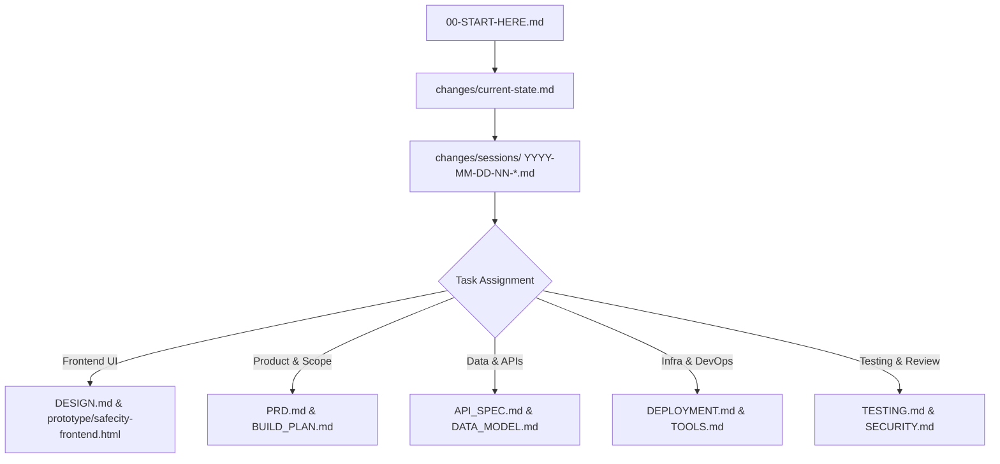

# 00-START-HERE — SafeCity AI Brain Index

> **One-Liner:** SafeCity AI detects approaching emergency ambulances via CCTV, calculates the fastest route to City Hospital, and pre-empts traffic signals to green in real time on an emergency operations dashboard.
>
> **Current Phase:** Phase 0 — Scaffolding & Brain Finalized. Frontend implementation beginning.
> **Active Focus:** Frontend dashboard construction against mock-first API contracts.

---

## Mandatory Reading Order for Agents & Engineers

1. **Step 1:** Read this index file.
2. **Step 2:** Read [changes/current-state.md](file:///c:/Users/ATECH/Desktop/Hachathon/brain/changes/current-state.md) to understand verified working reality vs unverified claims.
3. **Step 3:** Read the last 3 session files in [changes/sessions/](file:///c:/Users/ATECH/Desktop/Hachathon/brain/changes/sessions/).
4. **Step 4:** Open your task-specific document below.

---

## Complete Brain Document Directory

| Document | Purpose | Target Audience | Line Limit |
|---|---|---|---|
| [PRD.md](file:///c:/Users/ATECH/Desktop/Hachathon/brain/PRD.md) | Problem, demo-critical feature, user stories, acceptance criteria, scope | All / Product | < 300 |
| [ARCHITECTURE.md](file:///c:/Users/ATECH/Desktop/Hachathon/brain/ARCHITECTURE.md) | System components, data flows, diagrams, conventions | Engineering | < 300 |
| [DATA_MODEL.md](file:///c:/Users/ATECH/Desktop/Hachathon/brain/DATA_MODEL.md) | Database entities, schema, relations, RLS, seed data plan | Backend / DB | < 300 |
| [API_SPEC.md](file:///c:/Users/ATECH/Desktop/Hachathon/brain/API_SPEC.md) | REST endpoints, payloads, mock JSON contracts, error schema | Full Stack | < 300 |
| [DESIGN.md](file:///c:/Users/ATECH/Desktop/Hachathon/brain/DESIGN.md) | Solid color tokens, typography, spacing, component states | Frontend | < 300 |
| [TOOLS.md](file:///c:/Users/ATECH/Desktop/Hachathon/brain/TOOLS.md) | Catalog picks, limits, gotchas, account setup, fallbacks | DevOps / All | < 300 |
| [BUILD_PLAN.md](file:///c:/Users/ATECH/Desktop/Hachathon/brain/BUILD_PLAN.md) | 4-hour timeboxed schedule, owners, checklists, cut list | PM / All | < 300 |
| [TESTING.md](file:///c:/Users/ATECH/Desktop/Hachathon/brain/TESTING.md) | Manual critical-path test checklist, minimal tests, Lighthouse | QA / Dev | < 300 |
| [DEPLOYMENT.md](file:///c:/Users/ATECH/Desktop/Hachathon/brain/DEPLOYMENT.md) | Vercel setup, env config, preview vs prod, smoke tests | DevOps | < 300 |
| [ENV.md](file:///c:/Users/ATECH/Desktop/Hachathon/brain/ENV.md) | Comprehensive dictionary of environment variables | Engineering | < 300 |
| [WORKFLOW.md](file:///c:/Users/ATECH/Desktop/Hachathon/brain/WORKFLOW.md) | Human/Agent roles, PR flow, task loop, freeze rules | All | < 300 |
| [DECISIONS.md](file:///c:/Users/ATECH/Desktop/Hachathon/brain/DECISIONS.md) | Architecture Decision Records (ADRs) | Architecture | < 300 |
| [SECURITY.md](file:///c:/Users/ATECH/Desktop/Hachathon/brain/SECURITY.md) | RLS, token hygiene, Zod boundary validation, sanitization | Engineering | < 300 |
| [PRODUCTION_READINESS.md](file:///c:/Users/ATECH/Desktop/Hachathon/brain/PRODUCTION_READINESS.md) | MUST / SHOULD / SKIP hackathon readiness matrix | All | < 300 |
| [RISKS.md](file:///c:/Users/ATECH/Desktop/Hachathon/brain/RISKS.md) | Failure modes, downtime fallbacks, hackathon contingencies | PM / Leads | < 300 |
| [DEMO_PITCH.md](file:///c:/Users/ATECH/Desktop/Hachathon/brain/DEMO_PITCH.md) | 3-minute pitch script, slide outline, fallback plan | Presentation | < 300 |
| [GLOSSARY.md](file:///c:/Users/ATECH/Desktop/Hachathon/brain/GLOSSARY.md) | Domain terms: Green Corridor, Preemption, ETA, Confidence | All | < 300 |
| [ETHICS_PRIVACY.md](file:///c:/Users/ATECH/Desktop/Hachathon/brain/ETHICS_PRIVACY.md) | CCTV data minimization, no raw video storage, simulation notice | Legal / All | < 300 |

---

## Team Ownership Quick Reference
- **Abdul Wahid:** Frontend / UI (`/app/(dashboard)`, `/components`, `/styles`, `DESIGN.md`)
- **Zeeshan Maqsood:** Backend / DevOps (`/app/api`, `/lib`, `/supabase`, `/ml`, `DEPLOYMENT.md`)
- **Malik Faseeh Awan:** Pitch / Presentation (`/brain`, `/demo`, `/docs`, `DEMO_PITCH.md`)
