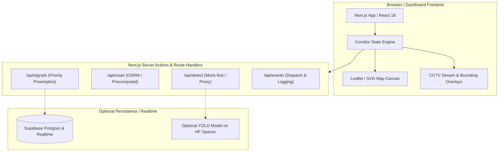
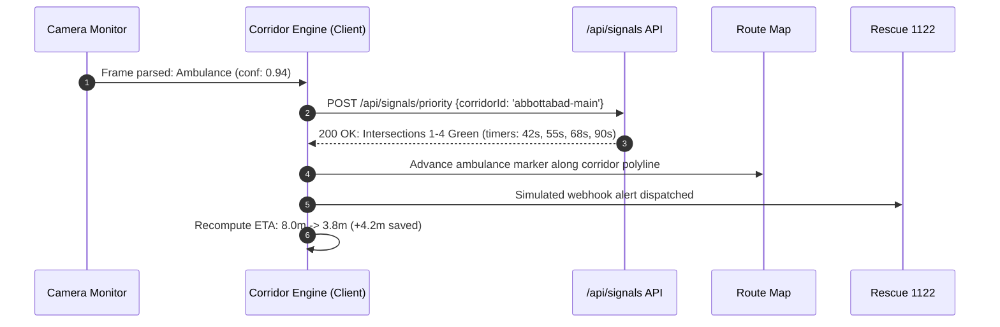

# System Architecture — SafeCity AI

---

## 1. High-Level Architecture Overview

SafeCity AI is structured as a resilient, mock-first Next.js 14 web application. It functions independently of external backends by utilizing strict contract-driven client state and mock fallbacks, while providing clean hooks for Supabase and an optional Python ML service.



---

## 2. Directory & Component Structure

```
├── /app
│   ├── layout.tsx                 # Root layout (Metadata, system font, theme provider)
│   ├── page.tsx                   # Main Dashboard entrypoint
│   └── /api                       # Mock-first contract routes
│       ├── /detect/route.ts       # Vehicle bounding box detection endpoint
│       ├── /route/route.ts        # Hospital corridor path & ETA endpoint
│       ├── /signals/route.ts      # Intersection states & priority controller
│       ├── /events/route.ts       # Corridor event log & dispatch alert
│       └── /health/route.ts       # Service health check
├── /components
│   ├── /layout
│   │   ├── Header.tsx             # Brand, Live clock, Active badge, Theme toggle
│   │   └── Sidebar.tsx            # Navigation drawer (<1100px collapsible)
│   ├── /monitor
│   │   ├── CameraFeed.tsx         # CCTV canvas/video + Bounding box overlays
│   │   ├── OfflineState.tsx       # Fallback visual when feed lost
│   │   └── StatCards.tsx          # Confidence, ETA, and speed metrics
│   ├── /map
│   │   ├── RouteMap.tsx           # Corridor tracking, intersections, moving ambulance
│   │   └── MapLegend.tsx          # Status indicators (Green, Ambulance, Hospital)
│   ├── /signals
│   │   ├── SignalsPanel.tsx       # Intersections 1–4 countdown grid
│   │   └── RouteProgress.tsx      # Linear progress bar towards City Hospital
│   ├── /events
│   │   ├── EventLog.tsx           # Chronological feed
│   │   └── EmptyEventState.tsx    # Clean state illustration
│   └── /ui                        # Atomic primitives (Button, Card, Modal, Input, Toast)
├── /lib
│   ├── mock-data.ts               # Scripted demo frames, corridor coords, signal states
│   ├── types.ts                   # Unified TypeScript interfaces
│   └── validation.ts              # Zod schemas for all contract payloads
└── /styles
    └── globals.css                # Design tokens & CSS variables
```

---

## 3. Data & State Flow



---

## 4. Code Conventions & Standards

1. **Strict TypeScript:** `noImplicitAny: true`, zero `any` types. All domain models must be typed via [lib/types.ts](file:///c:/Users/ATECH/Desktop/Hachathon/lib/types.ts).
2. **Boundary Validation:** Every incoming API request and parsed external payload must be validated with Zod:
   ```ts
   import { z } from 'zod';
   export const DetectionSchema = z.object({
     class: z.enum(['ambulance', 'car', 'motorcycle', 'truck']),
     confidence: z.number().min(0).max(1),
     bbox: z.tuple([z.number(), z.number(), z.number(), z.number()]),
   });
   ```
3. **Consistent Error Envelope:**
   ```json
   {
     "success": false,
     "error": {
       "code": "CAMERA_STREAM_TIMEOUT",
       "message": "CCTV-01 failed to deliver frame within 2000ms",
       "timestamp": "2026-10-15T11:00:00.000Z"
     }
   }
   ```
4. **Token-Only Styling:** No ad-hoc colors. All CSS classes or inline SVG attributes must consume variables from [brain/DESIGN.md](file:///c:/Users/ATECH/Desktop/Hachathon/brain/DESIGN.md).
5. **Typography & Tabular Numerics:** Root layout loads `GeistSans` (`geist/font/sans`) with fallback to `Neue Haas Grotesk Text Pro`, and enforces `font-variant-numeric: tabular-nums` for all dynamic countdowns, speed metrics, and clocks.
6. **Strict No-Emoji Mandate:** All visual icons and map markers must use Lucide React SVG vector components (`strokeWidth={2}`). Zero unicode emojis.
