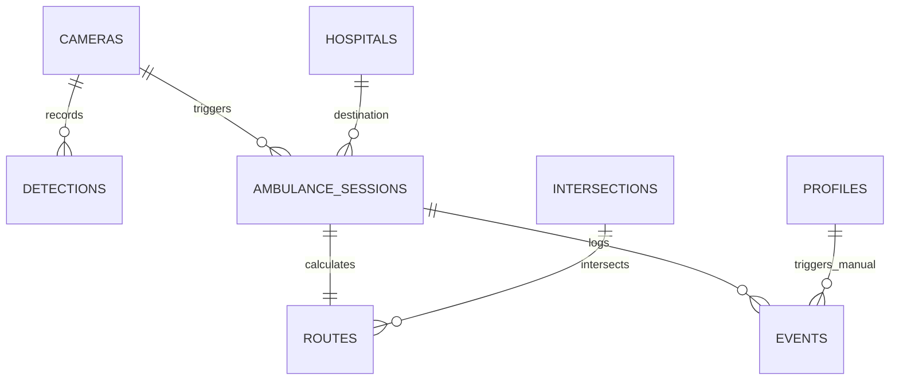

# Data Model & Schema — SafeCity AI

---

## 1. Entity-Relationship Overview

---

## 2. Table Definitions (PostgreSQL / Supabase)

### `cameras`
| Column | Type | Constraints | Description |
|---|---|---|---|
| `id` | UUID | PRIMARY KEY, DEFAULT gen_random_uuid() | Unique camera identifier |
| `name` | TEXT | NOT NULL | Camera label (e.g. `CCTV-01 Main Boulevard`) |
| `location` | TEXT | NOT NULL | Intersection or landmark name |
| `stream_url` | TEXT | NOT NULL | Demo video or RTSP mock URL |
| `status` | TEXT | CHECK (status IN ('active', 'offline', 'degraded')) | Operational state |

### `intersections`
| Column | Type | Constraints | Description |
|---|---|---|---|
| `id` | UUID | PRIMARY KEY, DEFAULT gen_random_uuid() | Unique intersection identifier |
| `name` | TEXT | NOT NULL | e.g. `Int-01 Main/Jinnah` |
| `lat` | NUMERIC(10, 6) | NOT NULL | Latitude (Abbottabad ~34.1688) |
| `lng` | NUMERIC(10, 6) | NOT NULL | Longitude (Abbottabad ~73.2215) |
| `signal_state` | TEXT | CHECK (signal_state IN ('green', 'amber', 'red')) | Active light color |
| `timer_seconds` | INTEGER | NOT NULL DEFAULT 45 | Remaining countdown seconds |
| `priority_mode` | BOOLEAN | DEFAULT false | True if green preemption is engaged |

### `hospitals`
| Column | Type | Constraints | Description |
|---|---|---|---|
| `id` | UUID | PRIMARY KEY, DEFAULT gen_random_uuid() | Hospital identifier |
| `name` | TEXT | NOT NULL | e.g. `City Hospital Abbottabad` |
| `lat` | NUMERIC(10, 6) | NOT NULL | Destination Latitude (~34.1750) |
| `lng` | NUMERIC(10, 6) | NOT NULL | Destination Longitude (~73.2350) |

### `ambulance_sessions`
| Column | Type | Constraints | Description |
|---|---|---|---|
| `id` | UUID | PRIMARY KEY, DEFAULT gen_random_uuid() | Active emergency corridor run |
| `camera_id` | UUID | REFERENCES cameras(id) | Camera that initiated detection |
| `hospital_id` | UUID | REFERENCES hospitals(id) | Target hospital |
| `status` | TEXT | CHECK (status IN ('in_transit', 'arrived', 'cancelled')) | Run state |
| `speed_kmh` | NUMERIC(5, 2) | DEFAULT 55.0 | Telemetry speed |
| `progress` | NUMERIC(5, 2) | DEFAULT 0.0 | Corridor completion percentage (0–100) |
| `started_at` | TIMESTAMPTZ | DEFAULT now() | Dispatch timestamp |

### `routes`
| Column | Type | Constraints | Description |
|---|---|---|---|
| `id` | UUID | PRIMARY KEY, DEFAULT gen_random_uuid() | Route ID |
| `ambulance_session_id` | UUID | REFERENCES ambulance_sessions(id) ON DELETE CASCADE | Associated session |
| `polyline` | TEXT | NOT NULL | Encoded GeoJSON / polyline string |
| `distance_km` | NUMERIC(5, 2) | NOT NULL DEFAULT 1.80 | Total route distance |
| `eta_seconds` | INTEGER | NOT NULL DEFAULT 225 | Current ETA with corridor |

### `detections`
| Column | Type | Constraints | Description |
|---|---|---|---|
| `id` | UUID | PRIMARY KEY, DEFAULT gen_random_uuid() | Detection record |
| `camera_id` | UUID | REFERENCES cameras(id) | CCTV source |
| `class` | TEXT | NOT NULL | `ambulance`, `car`, `motorcycle` |
| `confidence` | NUMERIC(4, 3) | NOT NULL | Confidence score (0.000 to 1.000) |
| `bbox` | JSONB | NOT NULL | `[x, y, width, height]` coordinates |
| `detected_at` | TIMESTAMPTZ | DEFAULT now() | Detection frame timestamp |

### `events`
| Column | Type | Constraints | Description |
|---|---|---|---|
| `id` | UUID | PRIMARY KEY, DEFAULT gen_random_uuid() | Event ID |
| `session_id` | UUID | REFERENCES ambulance_sessions(id) | Linked corridor session |
| `type` | TEXT | NOT NULL | `DETECTION`, `PREEMPTION`, `ALERT`, `ARRIVED` |
| `title` | TEXT | NOT NULL | Short summary |
| `detail` | TEXT | | Extended audit description |
| `created_at` | TIMESTAMPTZ | DEFAULT now() | Timestamp |

### `profiles` (Demo Admin)
| Column | Type | Constraints | Description |
|---|---|---|---|
| `id` | UUID | PRIMARY KEY | Matches Supabase Auth user ID |
| `full_name` | TEXT | NOT NULL | Operator Name |
| `role` | TEXT | DEFAULT 'dispatcher' | `dispatcher`, `traffic_officer`, `admin` |

---

## 3. Row-Level Security (RLS) & Access Rules
- `cameras`, `intersections`, `hospitals`, `routes`, `detections`, `events`: Public Read (`SELECT`) permitted so judges and guests can view the dashboard without authentication friction.
- Writes (`INSERT`, `UPDATE`) restricted to authenticated operators or server-side service role keys.

---

## 4. Hackathon Seed Data Plan (Minimal & Concrete)
- **1 Camera:** `CCTV-01 Main Boulevard` (`location: "Jinnah Road Intersection"`).
- **4 Intersections:**
  1. `Int-01 Main / Jinnah Road` (lat: 34.1688, lng: 73.2215, timer: 42s, green)
  2. `Int-02 Cantt Chowk` (lat: 34.1705, lng: 73.2250, timer: 55s, green)
  3. `Int-03 Mandian Road` (lat: 34.1728, lng: 73.2295, timer: 68s, green)
  4. `Int-04 Hospital Chowk` (lat: 34.1745, lng: 73.2335, timer: 90s, green)
- **1 Hospital:** `City Hospital Abbottabad` (lat: 34.1750, lng: 73.2350).
- **1 Demo Session:** Ambulance `#AB-901`, status `in_transit`, speed `58 km/h`, progress `38%`.
- **5 Events:** Detection recorded, route plotted, green corridor activated, Rescue 1122 notified, Int-01 passed.
- **1 Demo Account:** `admin@safecity.local` / `DemoSafeCity2026!`
