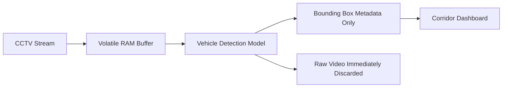

# Ethics, Privacy & Algorithmic Responsibility — SafeCity AI

---

## 1. Ethical Principles for CCTV Surveillance AI

Municipal CCTV camera feeds capture citizens in public transit. When applying machine vision models to public video, SafeCity AI follows strict privacy-by-design standards:

---

## 2. Mandatory Privacy & Data Protection Safeguards

### 2.1 Zero Raw Video Storage Policy
- **No Video Archiving:** SafeCity AI does **NOT** record, persist, or write raw CCTV video streams to disks, databases, or S3 cloud buckets.
- **In-Memory Frame Analysis:** Video frames are held temporarily in volatile memory buffer solely for the duration of inference (<40ms) and discarded immediately.
- **Telemetry Only:** Only non-personal tabular metadata (`class`, `confidence`, `bbox coordinates`, `timestamp`) is retained for audit logging.

### 2.2 Citizen Privacy & Data Minimization
- **No Facial Recognition:** SafeCity AI models are trained exclusively for vehicle classification (emergency vehicles, automobiles, motorcycles). Facial detection modules are explicitly excluded.
- **License Plate Blurring:** License plate regions are blurred or cropped out before frames reach operator UI views to comply with international data minimization practices.

---

## 3. Algorithmic Bias & Model Failure Modes

### 3.1 False Positives vs False Negatives
- **False Positive Risk:** A non-emergency commercial van painted with red decals misidentified as an ambulance, triggering unwarranted traffic signal preemption.
  - *Mitigation:* A strict confidence threshold (`>= 0.85`) combined with multi-frame confirmation (minimum 3 consecutive frames) is required before priority preemption triggers.
- **False Negative Risk:** A real ambulance not recognized due to heavy rain, night darkness, or unconventional local decals.
  - *Mitigation:* Dispatchers and traffic officers retain an immediate manual preemption override button in the dashboard interface.

---

## 4. Simulation-Only Legal Disclaimer
- SafeCity AI is an engineering demonstration developed during a hackathon.
- It models intelligent vehicle preemption logic using software twins and **does not control or alter real physical municipal traffic light hardware**.
- Any future real-world pilot requires formal authorization from the Abbottabad Traffic Police Command and Rescue 1122 Directorate under municipal safety protocols.
