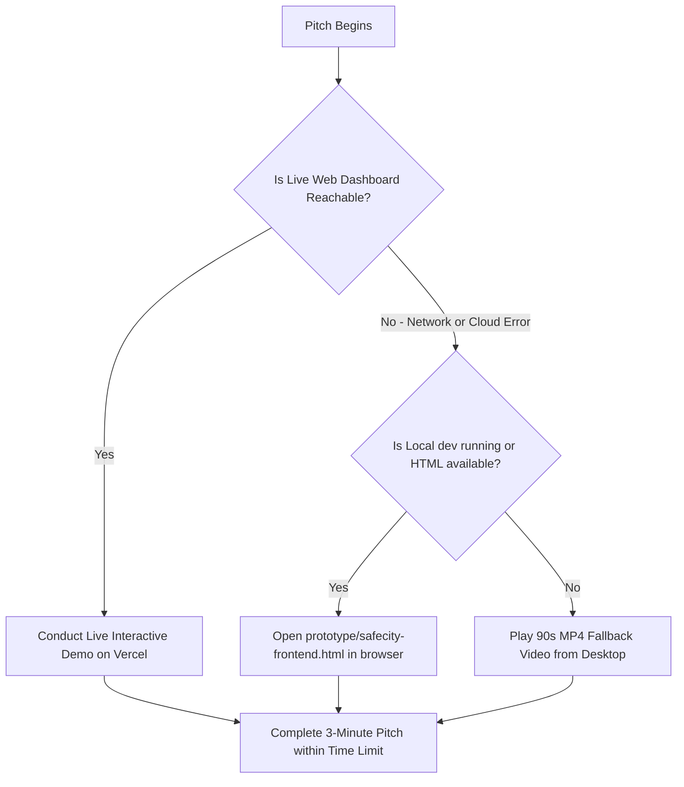

# Risk Management & Contingency Matrix — SafeCity AI

---

## 1. Hackathon Failure Modes & Immediate Mitigations

| Risk | Severity | Probability | Fallback / Contingency Plan |
|---|---|---|---|
| **ML Detection Model Fails or Times Out** | High | High | **Deterministic Scripted Mock:** `/api/detect` serves verified Abbottabad bounding box fixtures with 0ms latency. The frontend toggle seamlessly switches between mock and live if available. |
| **Vercel Deploy Breaks Near Deadline** | Critical | Medium | **Instant Rollback + Local Fallback:** Roll back in 1 click to the previous green deployment on Vercel. If cloud DNS fails, run local Next.js instance via `npm run dev` or open the standalone `prototype/safecity-frontend.html` directly. |
| **Wi-Fi / Network Drops During Pitch** | Critical | Medium | **Pre-Recorded Fallback Demo Video:** Pre-recorded 60–90 second MP4 demo video recorded at Minute 3:30 (`demo/safecity-fallback-demo.mp4`). Malik Faseeh Awan plays the local video immediately. |
| **Supabase Free Project Paused or Inactive** | High | Low | **In-Memory Fallback State:** `NEXT_PUBLIC_ENABLE_MOCK_FALLBACK=true` allows full interactive route recalculation, signal countdowns, and event logging in browser state without contacting Supabase. |
| **Scope Creep / Missing the 4:00 Deadline** | High | Medium | **Strict Cut List:** If any phase exceeds 20% allotted time, immediately drop SHOULD/COULD items in defined order: Drop Real ML -> Drop Analytics -> Drop Log Filters -> Drop Manual Overrides. |
| **Leaflet Map Tile CDN Rate Limiting** | Low | Low | **Vector SVG Corridor Canvas:** If OpenStreetMap tile servers are unreachable, the UI falls back to the embedded high-contrast SVG road schematic map built in the prototype. |

---

## 2. Decision Tree for Live Presentation Issues

