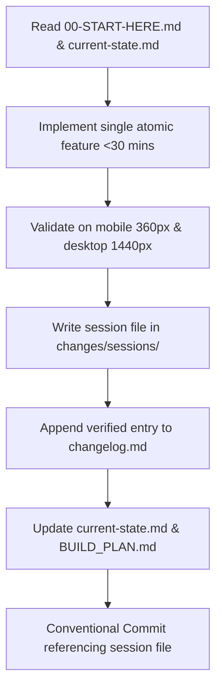

# Development Workflow & Agent Protocols — SafeCity AI

---

## 1. Team & Agent Roles Matrix

| Role | Operational Scope | Primary Output | Rules |
|---|---|---|---|
| **Planner** | Updates documentation, requirements, cut list, and schedules | `/brain/*.md` | Does NOT write code; ensures docs stay under 300 lines. |
| **Builder** | Implements one focused, scoped task within 30 minutes | `/components`, `/app` | Must adhere 100% to design tokens and mock contracts. |
| **Reviewer** | Audits code against PRD, DESIGN, SECURITY, and mobile view | PR comments / Audits | Verifies DoD before any branch merge. |

---

## 2. Git Branching & PR Rules
1. **Branch Format:** `<member-name>/<feature-or-fix-name>`
   - `wahid/port-prototype-shell`
   - `zeeshan/signals-mock-api`
   - `faseeh/demo-video-prep`
2. **Review Enforcement:** Every PR requires approval from a teammate *other* than the author.
3. **Single Deployer:** Only **Zeeshan Maqsood** merges into `main` and deploys to Vercel production.

---

## 3. The 30-Minute Task Loop
Every agent or human developer executes this exact loop:

---

## 4. Mandatory Logging System ("Git for Conversations")

### Step 1: Start-of-Work Verification
Before writing any code or modifying documentation:
- Read [00-START-HERE.md](file:///c:/Users/ATECH/Desktop/Hachathon/brain/00-START-HERE.md).
- Read [changes/current-state.md](file:///c:/Users/ATECH/Desktop/Hachathon/brain/changes/current-state.md).
- Read the last 3 session files in [changes/sessions/](file:///c:/Users/ATECH/Desktop/Hachathon/brain/changes/sessions/).

### Step 2: Post-Work Session File Creation
After **every** feature, fix, or architectural decision, create:  
`/brain/changes/sessions/YYYY-MM-DD-NN-short-title.md`  
Must contain:
- **Goal / Request:** Summary and quoted prompts.
- **What Was Done:** Exact files created or touched.
- **Decisions & Rationale:** Why chosen over alternatives.
- **Problems Encountered & Solutions:** What broke and how it was fixed.
- **Status:** Done / Partial / Blocked + explicit next steps.
- **Related Commit Hash:** Associated Git hash.

### Step 3: Changelog Update
Append a verified line to [changes/changelog.md](file:///c:/Users/ATECH/Desktop/Hachathon/brain/changes/changelog.md):  
`Change → Reason → Affected Area → Impact → Evidence → Status`

### Step 4: Current State Update
Update [changes/current-state.md](file:///c:/Users/ATECH/Desktop/Hachathon/brain/changes/current-state.md) with what actively runs, any incomplete tasks, and tag every claim as `[Verified]`, `[Inferred]`, or `[Unknown]`. Never invent history.

---

## 5. Dependency Freeze (Minute 180 / 3:00)
- At minute 180, zero new packages (`npm install <new-pkg>`) or third-party service accounts may be added.
- The remaining 60 minutes are reserved exclusively for bug fixing, UI polish, demo recording, and rehearsal.
